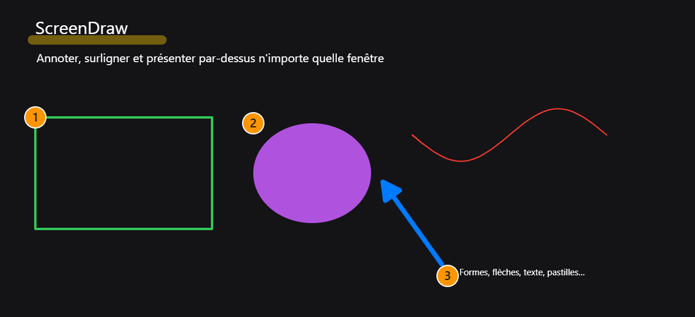
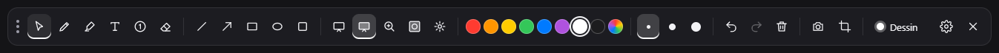
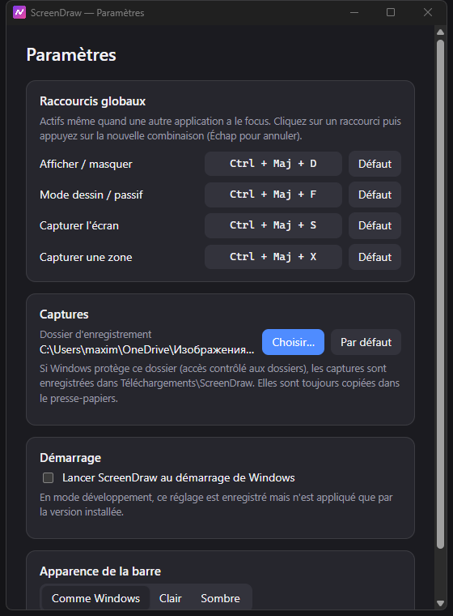

# ScreenDraw

**Annoter, surligner et présenter par-dessus n'importe quelle fenêtre.**
Une couche transparente sur tout l'écran (tous les écrans) pour expliquer quelque chose pendant
un partage d'écran, annoter une capture ou faire une présentation — sans toucher aux fenêtres
en dessous.

<!-- GIF de démo à venir : docs/demo.gif (enregistré avec ScreenToGif ou OBS). -->





> Windows en priorité · Electron + TypeScript strict · Canvas 2D sans framework · 128 tests

---

## Fonctionnalités

**Dessin**

- Stylo à main levée lissé, **sensible à la pression** avec un stylet (bout gomme reconnu)
- Surligneur semi-transparent, gomme vectorielle (supprime l'élément touché, pas des pixels)
- Ligne, flèche, rectangle, ellipse — `Maj` pour contraindre (45°, carré, cercle), plein ou contour
- Texte multiligne placé d'un clic, pastilles numérotées 1, 2, 3… pour décrire des étapes
- Sélection : déplacer ou supprimer un élément
- 8 couleurs + sélecteur, 3 épaisseurs + molette, annuler / rétablir **sur tous les écrans à la fois**

**Présentation**

- Pointeur laser qui s'efface en une seconde
- Projecteur : tout s'assombrit sauf un cercle autour du curseur — **même en mode passif**,
  on peut cliquer ses diapositives projecteur allumé
- Loupe sur une capture figée de l'écran, tableau blanc / noir

**Modes**

- Mode dessin : l'overlay capte la souris
- Mode passif : les annotations restent visibles, les clics traversent vers les applications

**Export et confort**

- Capture de l'écran ou d'une zone, annotations comprises : presse-papiers + PNG + notification
- Paramètres persistants, raccourcis globaux personnalisables, thème clair / sombre / comme Windows,
  lancement au démarrage



## Raccourcis

| Action                                                                  | Raccourci                                               |
| ----------------------------------------------------------------------- | ------------------------------------------------------- |
| Afficher / masquer                                                      | `Ctrl + Maj + D` (global, personnalisable)              |
| Mode dessin / passif                                                    | `Ctrl + Maj + F` (global, personnalisable)              |
| Capturer l'écran                                                        | `Ctrl + Maj + S` (global, personnalisable)              |
| Capturer une zone                                                       | `Ctrl + Maj + X` (global, personnalisable)              |
| Sélection · Stylo · Surligneur · Gomme                                  | `V` · `P` · `H` · `E`                                   |
| Ligne · Flèche · Rectangle · Ellipse                                    | `L` · `A` · `R` · `O`                                   |
| Texte · Numérotation                                                    | `T` · `N`                                               |
| Laser · Projecteur · Loupe                                              | `K` · `S` · `Z`                                         |
| Tableau blanc · noir                                                    | `W` · `B`                                               |
| Couleurs                                                                | `1` … `8` (touche physique : marche en AZERTY sans Maj) |
| Annuler · Rétablir                                                      | `Ctrl + Z` · `Ctrl + Y`                                 |
| Tout effacer (ou supprimer la sélection)                                | `Suppr`                                                 |
| Revenir en arrière (sélection, loupe, projecteur, tableau, mode dessin) | `Échap`                                                 |

Les raccourcis à une lettre ne fonctionnent qu'en mode dessin, jamais en global.

## Installation

**Version prête à l'emploi** : téléchargez `ScreenDraw-Setup-x.y.z.exe` (installeur) ou
`ScreenDraw-Portable-x.y.z.exe` dans les [Releases](https://github.com/makcnm57/idontknow/releases).
L'exécutable n'est pas signé : Windows SmartScreen peut afficher un avertissement
(« Informations complémentaires » → « Exécuter quand même »).

**Depuis les sources** (Node.js 22.12 ou plus récent) :

```bash
npm install
npm run dev      # lancer en développement
npm run test     # tests Vitest
npm run lint     # ESLint
npm run dist     # installeur NSIS + version portable dans release/
```

> **Accès contrôlé aux dossiers** (Windows Defender) : s'il est activé, Windows bloque
> l'écriture dans Images. Les captures sont alors enregistrées dans `Téléchargements\ScreenDraw`
> (et toujours copiées dans le presse-papiers). Pour utiliser Images, autorisez ScreenDraw dans
> _Sécurité Windows › Protection contre les ransomware_.

## Stack et choix techniques

| Élément    | Choix                                                               | Pourquoi                                                             |
| ---------- | ------------------------------------------------------------------- | -------------------------------------------------------------------- |
| Bureau     | Electron 45                                                         | Fenêtres transparentes, toujours au premier plan, raccourcis globaux |
| Outillage  | electron-vite + TypeScript **strict**                               | Build rapide, trois pages renderer, types partagés                   |
| Rendu      | Canvas 2D natif                                                     | Plein écran fluide en 1440p/4K, sans framework                       |
| Main levée | [perfect-freehand](https://github.com/steveruizok/perfect-freehand) | Traits lisses, pression du stylet                                    |
| Interface  | HTML / CSS / TypeScript                                             | La barre et les paramètres n'ont pas besoin de React                 |
| Qualité    | ESLint, Prettier, Vitest                                            | Toute la logique pure est testée                                     |

Quelques décisions structurantes :

- **Modèle vectoriel** : chaque élément est un objet ; l'écran est redessiné à partir de la liste.
  C'est ce qui rend possibles la gomme par élément, la sélection, l'annulation et l'export.
- **Deux calques canvas** : un calque « figé » redessiné seulement quand la liste change, et un
  calque « actif » pour le tracé en cours. Redessins groupés dans `requestAnimationFrame`.
- **Historique par instantanés immuables** : une étape = un tableau de références. Ajout, gomme,
  « tout effacer » et déplacement s'annulent de la même façon, sans logique d'inversion.
- **Historique global multi-écrans** : chaque écran garde ses instantanés, le processus main
  retient l'ordre des actions. Annuler rejoue la dernière action, quel que soit l'écran.
- **Un outil = un fichier** qui implémente la même interface, enregistré dans un registre ; pas de
  `switch` géant. Même principe pour le rendu, le hit-test et les transformations de chaque forme.
- **Sécurité Electron** : `contextIsolation`, `sandbox`, pas de Node dans le renderer, API ciblée
  via `contextBridge`, canaux IPC typés et centralisés, **toute donnée venant d'un renderer est
  validée** dans le main (et l'émetteur vérifié).

Architecture détaillée : [docs/architecture.md](docs/architecture.md).

## Ce que j'ai appris

- **IPC Electron et sécurité** — Typer les canaux une fois (`shared/ipc-channels.ts`) et en
  dériver le preload et les gestionnaires évite toute désynchronisation. Le renderer est traité
  comme non fiable : patchs d'état, rectangles de capture, chemins de dossier et raccourcis sont
  revalidés côté main, avec le même validateur que pour le fichier de paramètres relu au démarrage.
- **Rendu canvas** — Le HiDPI (`largeur × devicePixelRatio` puis `ctx.scale`), les
  `getCoalescedEvents()` pour ne perdre aucun point de stylet, la mise en cache des `Path2D` des
  formes terminées, et le fait que Chromium **ne dessine pas un segment de longueur nulle** même
  avec des extrémités arrondies.
- **Multi-écrans** — Une fenêtre par écran suivie aux branchements, un historique global au-dessus
  d'historiques locaux, des captures en pixels physiques (×1,5 à 150 %) et des centres calculés en
  entiers pour qu'une fenêtre ne dérive pas d'un pixel à chaque lancement.
- **Fenêtres sous Windows** — C'est là que se trouvaient les vrais pièges :
  `blur()` donne le focus à la fenêtre visible suivante (souvent un autre overlay) ;
  `setFocusable(false)` appelle `blur()` ; le niveau relatif « au-dessus » est ignoré hors macOS ;
  `moveTop()` réaffiche une fenêtre masquée ; une fenêtre non activable ne se déplace plus par
  `-webkit-app-region: drag` (glissé réécrit en JavaScript) ; le sélecteur de couleur exige une
  fenêtre active. Chaque contournement est commenté dans le code.
- **Le système compte autant que le code** — L'accès contrôlé aux dossiers de Defender bloquait les
  écritures dans Images **sans renvoyer d'erreur** : un délai maximal (`withTimeout`) et un dossier
  de repli rendent la capture robuste.
- **Tester en vrai** — En plus des tests Vitest, chaque fonctionnalité a été testée sur la vraie
  application (souris et clavier simulés, état lu via le protocole DevTools, captures d'écran). Ces
  tests ont révélé une dizaine de bugs invisibles aux tests unitaires.

## Limites connues

- Mise en évidence des clics non implémentée : en mode passif les clics traversent l'overlay, il
  faudrait un hook souris natif (dépendance native écartée pour l'instant).
- La loupe grossit une capture figée (une vidéo derrière ne bouge pas dans la loupe).
- Un texte validé ne se modifie pas (on peut le déplacer, l'effacer et le retaper).
- Développé et testé sous Windows 11 ; macOS et Linux non testés.

## Licence

[MIT](LICENSE) © 2026 Kawa
