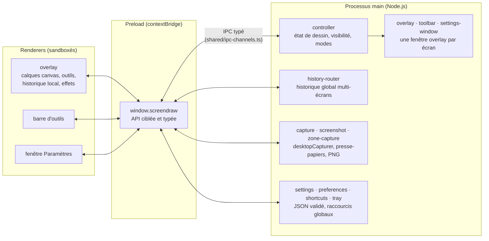

# Architecture

ScreenDraw suit le découpage d'Electron en trois couches. Le **main** possède l'état et les
fenêtres ; le **preload** expose une API minimale ; les **renderers** dessinent et affichent.
Aucun renderer n'a accès à Node.js (`contextIsolation`, `sandbox`, `nodeIntegration: false`).



## Flux principaux

**État de dessin** — Outil, couleur, épaisseur, mode, tableau, projecteur, loupe : une seule
source de vérité dans `main/controller.ts`. Un renderer envoie une _demande_ de modification
(`state:update`) ; le main la valide (`shared/draw-state.ts`), l'applique et diffuse le nouvel
état à toutes les fenêtres (`state:changed`). La barre d'outils et les raccourcis clavier restent
ainsi synchronisés sans état local.

**Historique** — Chaque overlay garde ses instantanés de formes (`renderer/overlay/history.ts`)
et signale chaque nouvelle étape au main. `main/global-history.ts` retient l'ordre des étapes et
sur quel(s) écran(s) elles ont eu lieu : annuler renvoie l'ordre au bon overlay. « Tout effacer »
forme un groupe annulé d'un seul coup sur tous les écrans.

**Dessin** — Dans l'overlay, chaque outil (`renderer/overlay/tools/`) implémente la même
interface et produit des formes vectorielles. Le rendu, le hit-test (gomme, sélection) et les
transformations de chaque type de forme sont rangés dans des tables indexées par `kind` : ajouter
une forme, c'est ajouter une entrée, TypeScript signale les oublis.

**Capture** — Le main masque la barre, demande à l'overlay de retirer son interface (liseré,
cadre de sélection, loupe) et attend sa confirmation, capture l'écran en pixels physiques, puis
restaure tout. L'image va d'abord dans le presse-papiers, ensuite sur le disque (avec délai
maximal et dossier de repli si Windows bloque l'écriture).

**Paramètres** — `settings.json` dans le dossier de données de l'application. Relu au démarrage
avec les mêmes validateurs que l'IPC (`shared/preferences.ts`, `main/settings-schema.ts`) :
un fichier corrompu ou modifié à la main redonne simplement les valeurs par défaut.

## Arborescence

```
src/
├── main/        processus principal : fenêtres, état, IPC, captures, paramètres
├── preload/     API exposée aux renderers (contextBridge)
├── renderer/
│   ├── overlay/   canvas de dessin : calques, outils, formes, effets de présentation
│   ├── toolbar/   barre d'outils
│   └── settings/  fenêtre Paramètres
└── shared/      types, canaux IPC, validation et logique pure (testés avec Vitest)
```
